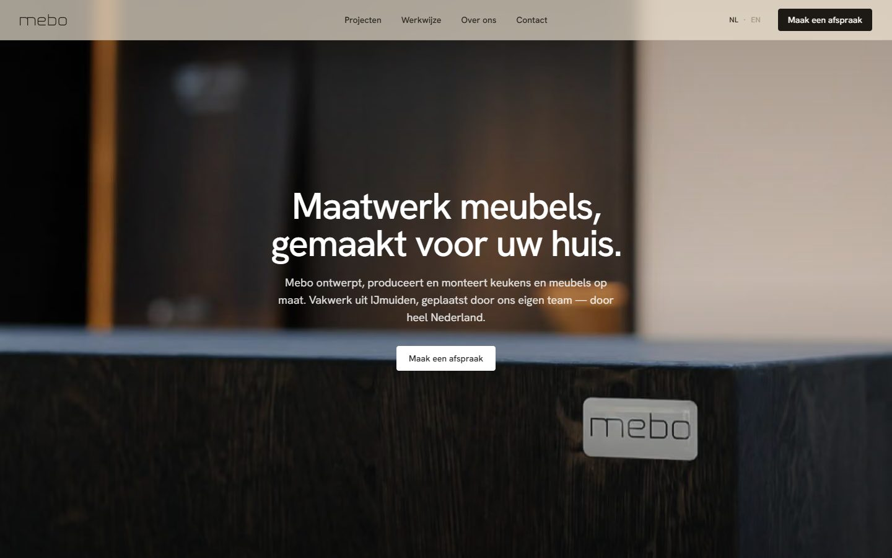
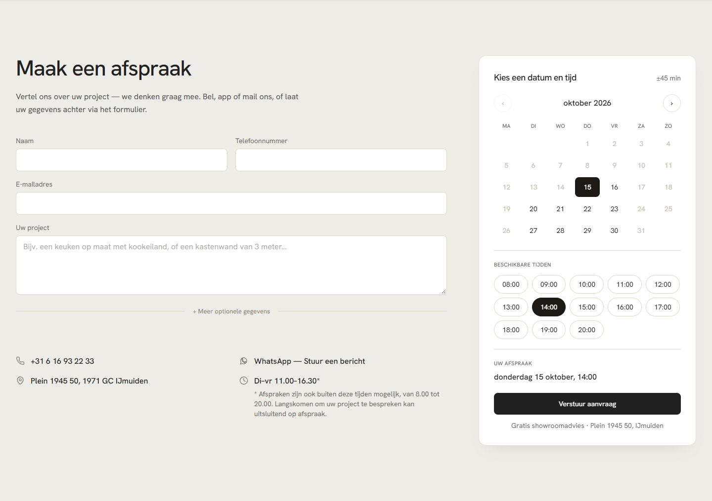
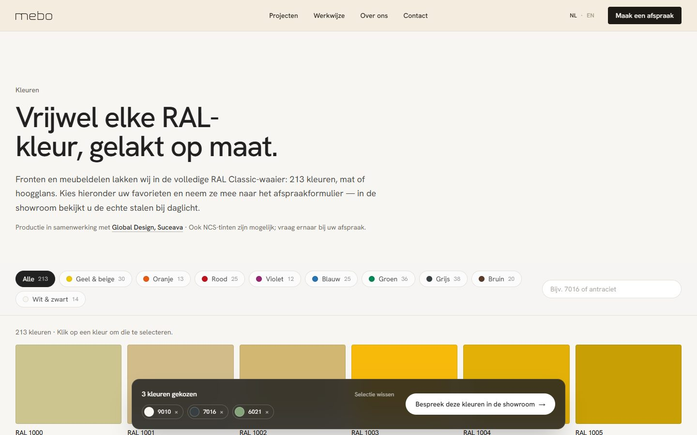
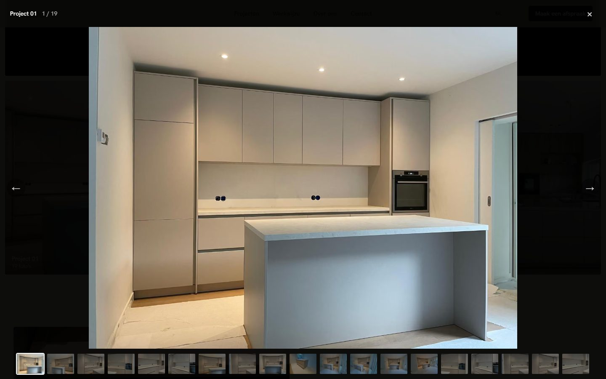
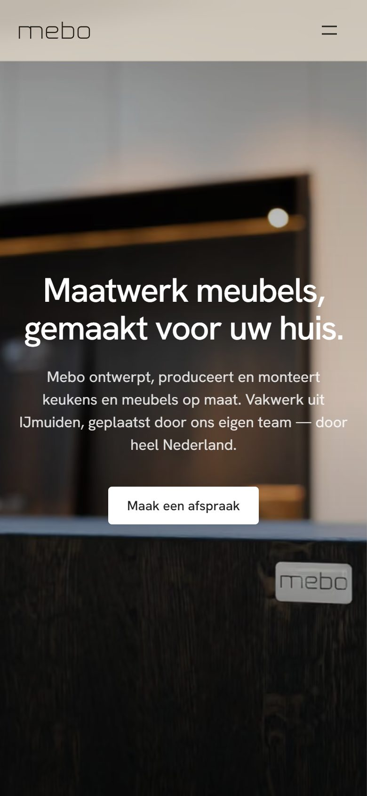
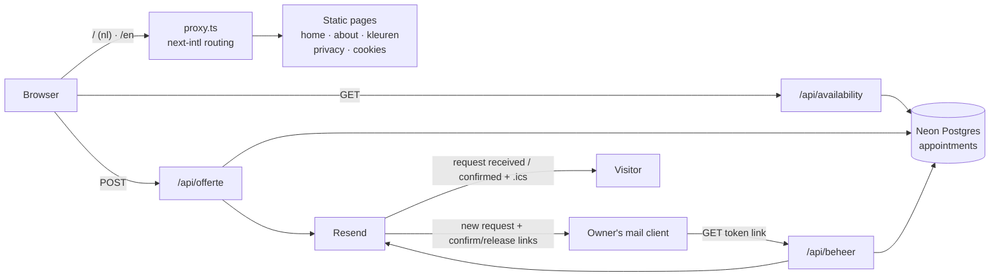

# Mebo Keukens — website

[](https://github.com/Andeaf/mebo/actions/workflows/ci.yml)

Marketing and lead-generation website for Mebo Keukens, a custom kitchen and
furniture workshop in IJmuiden, the Netherlands. Visitors browse finished
projects and materials, pick a RAL colour, and book a showroom appointment in
a time slot that is reserved atomically and confirmed by the owner from an
email.

**Live:** [www.mebokeukens.nl](https://www.mebokeukens.nl) · Dutch at `/`,
English at `/en`.

**Status:** in production since August 2026 and actively maintained. The
booking, email, colour and consent features below are live; the roadmap lists
what is still open.

## Screenshots

| Homepage | Appointment booking |
| --- | --- |
|  |  |
| **RAL colour page** | **Project gallery** |
|  |  |

<p align="center"></p>

## Features

- **Bilingual site** with Dutch as the default locale at the root URL and
  English under `/en`. No `Accept-Language` redirects: the language is an
  explicit choice, which keeps URLs stable for search engines. Every page
  ships `hreflang` alternates and a sitemap.
- **Showroom appointment booking.** A calendar shows live availability per
  month, the visitor picks a day and hour, and the request is stored in
  Postgres. A partial unique index guarantees that a slot can only be taken
  once, even under concurrent requests.
- **Owner workflow without a login.** The owner receives an email with
  *Confirm* and *Release slot* links. Each link carries a per-appointment
  random token; confirming emails the visitor a bilingual confirmation with an
  `.ics` calendar file, releasing frees the slot on the site.
- **Abuse protection** on the form: honeypot field, minimum time-on-page,
  server-side validation of every field and of the slot itself, and a
  per-IP daily booking limit.
- **Project gallery** with a lightbox and a swipeable carousel on mobile.
- **RAL colour page** with all 213 RAL Classic shades the production partner
  paints, searchable by code or name. A chosen colour is carried into the
  appointment form.
- **Process section** with expandable panels for the design partner and the
  production partner's finish palette.
- **Privacy-first marketing.** Ad pixels (Meta, TikTok, Google Ads,
  Pinterest) load only when their IDs are configured *and* the visitor
  accepts marketing cookies. Without IDs there is no banner and no
  third-party script at all. Privacy and cookie statements are included in
  both languages.
- **Cookieless analytics** through Vercel Web Analytics.
- **SEO basics:** per-locale metadata, Open Graph image, JSON-LD for the
  business, `robots.txt` and `sitemap.xml` generated from one source of truth.
- **Graceful degradation.** Without a database every slot is shown as free;
  without an email provider the form opens the visitor's mail client instead.
  No request is lost when a dependency is missing.

## Tech stack

| Layer | Choice |
| --- | --- |
| Framework | Next.js 16.4 (App Router, static generation, Turbopack) |
| UI | React 19.2, TypeScript 6.0, Tailwind CSS 4.3, Framer Motion 12 |
| i18n | next-intl 4.13 (routing proxy, static params per locale) |
| Data | Neon serverless Postgres via `@neondatabase/serverless` 1.1 |
| Email | Resend HTTP API (no SDK), plain-text and HTML with `.ics` attachments |
| Analytics | Vercel Web Analytics 2.0 |
| Hosting | Vercel, domain and DNS at TransIP |
| Runtime | Node.js 24 |

## Architecture



- All marketing pages are prerendered per locale at build time
  (`generateStaticParams`); the three API routes are the only server code.
- `src/lib/company.ts` is the single source for business data used in the
  footer, metadata, JSON-LD, emails and the sitemap.
- All copy lives in `messages/nl.json` and `messages/en.json`, with identical
  key sets.
- The appointment table is created on first use (`src/lib/db.ts`); the
  partial unique index `ON appointments (date, time) WHERE status <> 'released'`
  is the double-booking guarantee.

## Running locally

Prerequisites: Node.js 20.9 or newer (developed on 24) and npm.

```bash
git clone https://github.com/Andeaf/mebo.git
cd mebo
npm install
cp .env.example .env.local   # optional, see Configuration
npm run dev                  # http://localhost:3000
```

Other scripts:

```bash
npm run build          # production build (also runs the type check)
npm run start          # serve the production build
npm run placeholders   # design aid: overwrites the section photos and OG image
                       # with grey placeholders (do not run on production assets)
npx tsc --noEmit       # type check only
```

### Configuration

Every variable is optional. With none of them set the site runs fully, with
the booking form falling back to `mailto:` and the calendar showing every slot
as free. See [`.env.example`](.env.example) for comments on each one.

| Variable | Purpose |
| --- | --- |
| `RESEND_API_KEY` | Enables transactional email through Resend. |
| `QUOTE_FROM_EMAIL` | Sender address on a domain verified in Resend. |
| `QUOTE_TO_EMAIL` | Inbox for appointment requests (defaults to the company email). |
| `DATABASE_URL` | Postgres connection string; enables slot reservation. |
| `NEXT_PUBLIC_META_PIXEL_ID` | Meta pixel, loaded only after consent. |
| `NEXT_PUBLIC_TIKTOK_PIXEL_ID` | TikTok pixel, loaded only after consent. |
| `NEXT_PUBLIC_GOOGLE_ADS_ID` | Google Ads tag (`AW-…`), loaded only after consent. |
| `NEXT_PUBLIC_GOOGLE_ADS_LEAD_LABEL` | Google Ads conversion label for a sent request. |
| `NEXT_PUBLIC_PINTEREST_TAG_ID` | Pinterest tag, loaded only after consent. |

## Testing

There is no automated test suite yet. Continuous integration runs the
TypeScript check and a full production build on every push and pull request.
The booking flow (availability, request, owner confirm and release, visitor
emails) has been verified manually end-to-end on the production deployment.

A natural next step is a Playwright smoke test for the booking flow and unit
tests for slot validation and the `.ics` builder.

## Design decisions worth discussing

- **Double booking is solved in the database, not in code.** Instead of
  locks or a check-then-insert, a partial unique index rejects a second
  active booking for the same slot; the API maps the Postgres `23505` error
  to a `409` and the client refreshes availability.
- **Capability links instead of an admin panel.** The owner acts on
  appointments from their email through 64-character random tokens. No
  accounts, no sessions, no password reset, and the attack surface is one
  read-only route that answers with a plain HTML page.
- **Availability is computed client-side.** Pages are statically generated,
  so "today" cannot come from the build. The calendar fetches booked slots
  per month and derives everything else in the browser; the server
  re-validates the slot in the showroom's timezone on submit.
- **Dates and times are stored as text.** `YYYY-MM-DD` and `HH:MM` in
  Europe/Amsterdam avoid timezone ambiguity between a UTC server, a Dutch
  showroom and a visitor anywhere.
- **Every integration is optional.** Email, database and pixels each degrade
  to a safe behaviour when unconfigured, which keeps local development and
  preview deployments free of secrets.
- **Consent is enforced at script-injection time.** Marketing scripts are
  never in the HTML until consent is granted; withdrawing consent also
  removes the first-party cookies the pixels set.
- **Dutch at the root, no language sniffing.** Chosen for a local business
  whose customers and search traffic are Dutch; English is a deliberate
  opt-in.

## Known limitations

- Confirm and release are `GET` links, which is what mail clients can open.
  A link-scanning mail gateway could in theory trigger an action; a
  confirmation page with a button would be safer.
- The schema is bootstrapped with `CREATE TABLE IF NOT EXISTS`; there is no
  migration tooling, which is fine for one table and would not scale.
- The per-IP limit relies on the `x-forwarded-for` header set by the host.
- Project photos are currently the Instagram-resolution versions; originals
  are being collected.
- No automated tests (see Testing).

## Roadmap

- Showroom section with a map and directions.
- Downloadable PDF brochure.
- Custom 404 page.
- Replace gallery photos with original high-resolution captures.
- Automated tests for the booking flow (see Testing).

## License

Source-available, all rights reserved. The code may be read for reference;
see [LICENSE](LICENSE). The Mebo name, logo, photographs and texts belong to
Mebo Keukens and are not licensed for reuse.
